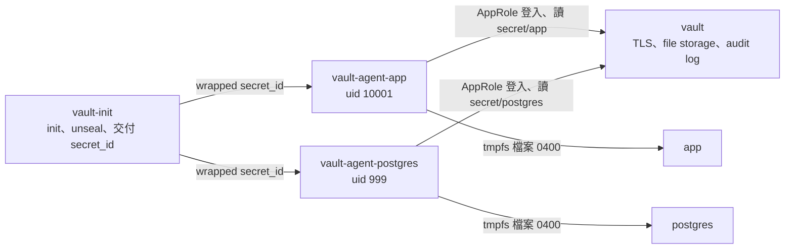

# [Vault](https://developer.hashicorp.com/vault) 私鑰與加密管理系統

在 Docker（非 Swarm 模式）環境下，原生 `secrets` 功能僅能讀取主機上的實體明文檔案，缺乏如 Podman secrets 原生將機密存放於記憶體（tmpfs）的保護機制。

本 Lab 示範以 **HashiCorp Vault + Vault Agent Sidecar** 在 Compose 環境中交付機密，並套用 Vault 官方的[正式環境強化建議](https://developer.hashicorp.com/vault/docs/concepts/production-hardening)中適用於單機 Lab 的部分：

- **TLS**：Vault 只開 HTTPS，憑證由 Lab 專用的 CA 簽發；CA 私鑰留在主機目錄，不掛進任何容器、也不打包進映像檔。
- **稽核紀錄**：啟用 file audit device，每次存取都寫進 `vault_audit` volume。
- **不保留 root token**：初始化與設定完成後立即撤銷；需要時以 unseal key 走 `generate-root`（見「Break-glass」）。
- **最小權限**：每個應用程式一個 AppRole 與 policy，由 [`secrets.manifest`](./secrets.manifest) 產生，只能 `read` 自己的固定路徑，沒有 `list`、沒有萬用字元。
- **短效、單次使用的登入憑證**：`secret_id` 只能用一次、10 分鐘內有效，而且只能以 response wrapping 交付（包裝 token 5 分鐘內有效），Agent 讀取後即刪除檔案。
- **明文不落地**：Vault Agent 以應用程式的 uid 執行，把每個機密渲染成 tmpfs 上權限 `0400` 的檔案，只有該 uid 讀得到。

## 能做到與做不到的

- **做不到**：防止能在應用程式程序內執行程式碼的攻擊取得機密。程序用得到的機密，攻擊者原則上都拿得到。
- **做得到**：每個應用程式只拿得到自己的機密；登入憑證短效且單次使用；每次存取留下稽核紀錄；機密不散落在 `.env` 或映像檔裡，輪替時只改一處。

## 架構



| 服務 | 說明 |
| --- | --- |
| `vault` | 單節點 Vault，file storage，只開 HTTPS（`127.0.0.1:8200`），沒有 Web UI（root token 撤銷後，不該有需要貼進瀏覽器的 token） |
| `vault-init` | 每次 `up` 執行一次後結束：第一次會初始化、設定、寫入隨機產生的示範機密並撤銷 root token；之後只在 Vault sealed 時 unseal，再重新交付 `secret_id` |
| `vault-agent-<app>` | 每個應用程式一個，以該應用程式的 uid 執行，每分鐘重新讀取並渲染機密 |
| `app` | 示範程式，只印出 `/run/secrets` 裡的檔名、權限與位元組數，不印出值 |

## 環境需求

- [Docker](https://www.docker.com/) >= 24.0.0 與 [Docker Compose](https://docs.docker.com/compose/) >= 2.20.0，或 [Podman](https://podman.io/) 與 [podman-compose](https://github.com/containers/podman-compose)
- [OpenSSL](https://www.openssl.org/)（產生 Lab 專用的 CA 與伺服器憑證）

## Getting Started

```sh
# 一次性：產生 Lab 專用的 CA 與 Vault 伺服器憑證到 certs/（已列入 .gitignore）
./scripts/tls-certs.sh

# 在背景啟動
docker compose up -d

# 查看初始化過程（不會印出任何 token、key 或機密值）
docker compose logs vault-init

# 查看 App 容器讀取 /run/secrets 的日誌
docker compose logs -f app

# 以 Lab CA 驗證 Vault 的 TLS 連線
curl --cacert certs/ca.crt https://localhost:8200/v1/sys/health
```

使用 Podman 時把 `docker compose` 換成 `podman-compose`。podman-compose 不一定等 `vault-init` 結束才啟動 Agent，也可能讓 `vault-init` 執行不只一次：Agent 找不到憑證時會自己重試，多交付的包裝 token 沒人使用，5 分鐘後失效。

第一次初始化若中途失敗，Lab 資料可以直接丟棄：`docker compose down -v` 後重來。

## 示範：對接真實資料庫 (PostgreSQL)

`compose.postgres.yml` 疊加一個 PostgreSQL 與它專屬的 Vault Agent。官方 PostgreSQL 映像檔以 `POSTGRES_PASSWORD_FILE` 讀取 Agent 渲染的密碼檔，該檔案只有 `postgres` 使用者（uid 999）讀得到：

```sh
docker compose -f compose.yml -f compose.postgres.yml up -d

# 以渲染出來的密碼經網路登入（密碼只在容器內讀取）
docker compose -f compose.yml -f compose.postgres.yml exec -u postgres postgres \
  sh -c 'PGPASSWORD="$(cat /run/secrets/POSTGRES_PASSWORD)" psql -h postgres -U postgres -d app -c "select 1"'
```

## 機密管理與維運

### 管理用 token

`vault-init` 撤銷 root token 前，會建立一個只能管理 `secret/` 底下 KV 的 `secret-admin` token，存在 `vault_state` volume（只因為 Lab 沒有個人帳號；正式環境應為每位維運人員各建一個帳號，例如 `userpass`，並綁定 `secret-admin` policy）。以下函式只在容器內讀出 token，不會印出：

```sh
vault_admin() {
  docker compose run --rm -T --no-deps --entrypoint sh vault-init \
    -c 'VAULT_TOKEN="$(cat /vault/state/admin-token)" exec vault "$@"' vault "$@"
}
vault_admin kv metadata get -mount=secret app
```

### 輪替機密

值從 stdin 讀取，不留在 shell history 或程序列表：

```sh
read -rs value && printf '%s' "$value" | vault_admin kv patch -mount=secret app API_KEY=-; unset value
```

一分鐘內 Agent 會重新渲染檔案。應用程式若只在啟動時讀取機密，還要重啟它：`docker compose restart app`。KV v2 會保留舊版本，可以 `vault kv rollback` 退回。

### 新增機密

1. 先寫入值（見上一節，entry 不存在時把 `patch` 換成 `put`）。Agent 遇到 manifest 有、Vault 沒有的名稱會停在渲染這一步，一直 unhealthy，所以值要先進 Vault。
2. 在 [`secrets.manifest`](./secrets.manifest) 加一行 `<entry> <名稱>`。
3. 加在既有 entry 底下時，重建該應用程式的 Agent 即可：`docker compose up -d --force-recreate vault-init vault-agent-app`。
4. 新增 entry（也就是新的應用程式）會改變 policy 與 AppRole，需要 root：照「Break-glass」以 `init.sh reconfigure` 重新套用，再為新應用程式加上 Agent、volume 與 `VAULT_AGENT_USERS` 中的 uid。

### Agent 重啟

Agent 的 `secret_id` 只能用一次，登入後拿到的是 1 小時的 periodic token，由 Agent 持續續期。Agent 重啟後需要新的 `secret_id`：

```sh
docker compose up -d --force-recreate vault-init vault-agent-app
```

Vault 停止或 sealed 時，已渲染的檔案在 Agent 或應用程式仍掛著 tmpfs volume 時不會消失。

### 稽核紀錄

```sh
docker compose exec vault tail -n 5 /vault/audit/audit.log
```

稽核紀錄中的機密值與 token 會以 HMAC 雜湊呈現。**沒有任何已啟用的 audit device 能寫入時，Vault 會拒絕該請求**；所有 audit device 都無法使用（例如磁碟滿）時，等同 Vault 停止服務（[Audit devices](https://developer.hashicorp.com/vault/docs/audit)）。file audit device 不會自己輪替檔案，輪替後要對 Vault 送 `SIGHUP` 重新開檔（[File audit device](https://developer.hashicorp.com/vault/docs/audit/file)）。

### Unseal

Vault 每次啟動都處於 sealed 狀態（[Seal/Unseal](https://developer.hashicorp.com/vault/docs/concepts/seal)）。本 Lab 只產生 1 份 unseal key，存放在 `vault_state` volume，`vault-init` 每次 `up` 都會自動 unseal。

**這是 Lab 才能接受的取捨**：key 與 Vault 資料在同一台主機上，對取得主機 root 的人沒有任何保護。正式環境應將 unseal key 分持給多人（`vault operator init` 的 `-key-shares`、`-key-threshold` 與 `-pgp-keys`），或改用 auto-unseal，把保護 unseal key 的責任交給 KMS、HSM 或 transit seal。備份 `vault_data` 時不要與 unseal key 放進同一份備份。

### mlock

`config/vault.hcl` 設定 `disable_mlock = true`，因此 `vault` 容器不需要 `IPC_LOCK` capability。Vault 官方不建議關閉 mlock，除非主機沒有 swap 或只使用加密的 swap（[`disable_mlock`](https://developer.hashicorp.com/vault/docs/configuration#disable_mlock)）。本 Lab 關閉的理由：unseal key 本來就放在同一顆磁碟上，讀得到 swap 的人也讀得到 key，mlock 擋不住什麼，卻要把整個 Vault 執行檔常駐鎖在記憶體裡。正式環境改用分持 key 或 auto-unseal 之後，要重新評估：保留 mlock，或關閉 swap／只用加密的 swap。

另外，`vault` 容器以 root 啟動，只為了把主機上權限 `600` 的 `tls.key` 複製給 vault 使用者，之後由映像檔的 entrypoint 降回 vault 使用者執行；映像檔中沒有 `setcap`，所以設定 `SKIP_SETCAP`。

### Break-glass：沒有 root token 時取得 root

Vault 2.0 起，`sys/generate-root` 除了 unseal key 之外也要帶有效的 token（[Important changes](https://developer.hashicorp.com/vault/docs/updates/important-changes)）。root 撤銷後沒有任何 token 能做這件事，所以要暫時以 `enable_unauthenticated_access` 恢復舊行為，用完立刻關掉（[Configuration](https://developer.hashicorp.com/vault/docs/configuration)，此設定可以 `SIGHUP` 重新載入）：

1. 取消 `config/vault.hcl` 最後一行 `enable_unauthenticated_access = ["generate-root"]` 的註解，再 `docker compose kill -s SIGHUP vault`。
2. 執行需要 root 的工作。`init.sh reconfigure` 會以 unseal key 與一次性密碼（OTP）產生 root token、依 `secrets.manifest` 重新套用 policy、AppRole 與交付用 token，接著撤銷 root token 並重新交付，全程不印出 token：

   ```sh
   docker compose run --rm vault-init reconfigure
   ```

   要手動操作時，流程是 `vault operator generate-root -init`（取得 nonce 與 OTP）→ 持有 unseal key 的人執行 `vault operator generate-root -nonce=<nonce> -`（從 stdin 讀 key）→ `vault operator generate-root -decode=<encoded token> -otp=<otp>`（[Generate root tokens](https://developer.hashicorp.com/vault/docs/troubleshoot/generate-root-token)）。用完立刻 `vault token revoke -self`。
3. 把那一行註解回去，再送一次 `SIGHUP`，確認未帶 token 的請求又被拒絕：

   ```sh
   docker compose exec vault vault read sys/generate-root/attempt   # 預期 403
   ```

   開著的期間，任何連得到 Vault 的人都能發起 root 產生流程（雖然仍需要 unseal key 才能完成）。每次使用都會留在稽核紀錄。

## 參考資料

- [Production hardening](https://developer.hashicorp.com/vault/docs/concepts/production-hardening)
- [TCP listener](https://developer.hashicorp.com/vault/docs/configuration/listener/tcp)
- [File audit device](https://developer.hashicorp.com/vault/docs/audit/file)
- [Tokens：root tokens](https://developer.hashicorp.com/vault/docs/concepts/tokens#root-tokens)
- [AppRole auth method](https://developer.hashicorp.com/vault/docs/auth/approle)
- [Response wrapping](https://developer.hashicorp.com/vault/docs/concepts/response-wrapping)
- [Policies：`min_wrapping_ttl`／`max_wrapping_ttl`](https://developer.hashicorp.com/vault/docs/concepts/policies)
- [Vault Agent AppRole auto-auth](https://developer.hashicorp.com/vault/docs/agent-and-proxy/autoauth/methods/approle)
- [Vault Agent templates](https://developer.hashicorp.com/vault/docs/agent-and-proxy/agent/template)
- [hashicorp/vault Docker image](https://hub.docker.com/r/hashicorp/vault)
